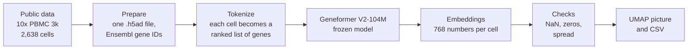
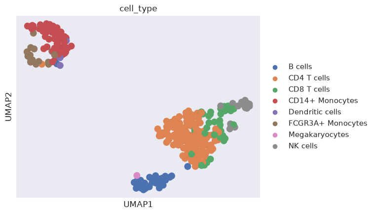

# Geneformer starter: a tutorial and a tested quickstart

Run [Geneformer](https://huggingface.co/ctheodoris/Geneformer), a model
trained on gene expression from millions of human cells, on a public dataset,
from a clean checkout. The repository has two parts:

- a **quickstart**: three commands that turn public blood-cell data into
  embeddings and a picture of the cell types, with automatic checks on the
  output, and
- a **tutorial** of eleven short lessons for readers who have never used a
  terminal, Python or a remote computer, including what we learned from long
  GPU runs.

## What it does



Geneformer reads a cell as a list of genes sorted from most to least
expressed (relative to the rest of the training data), and turns that list
into a vector of 768 numbers. Cells of the same type end up close together:



*300 randomly chosen cells from the quickstart. Cell-type names come from a
clustering of the same data (not an independent label), so this shows that the
embedding agrees with the clustering, not that it is correct about biology.*

## Quickstart

This starter assumes a small lab network of GPU machines that you reach with
[Tailscale](https://tailscale.com/) and SSH. The main route runs the job on
a GPU machine and fetches the result; running it on your own computer is the
fallback.

### Main route: on a GPU machine over Tailscale and SSH

With the GPU machine (here `gpu-box-1`) on your tailnet and `ssh gpu-box-1`
working ([lesson 3](tutorial/03-remote-machines.md) sets this up from
scratch), run on your laptop:

```bash
git clone https://github.com/Kays3/geneformer-petadimension-starter.git
cd geneformer-petadimension-starter/quickstart
./remote_run.sh gpu-box-1 check    # disk, memory, GPU, tools
./remote_run.sh gpu-box-1 start    # runs setup and the quickstart in tmux on the machine
./remote_run.sh gpu-box-1 status   # RUNNING, plus the log tail
./remote_run.sh gpu-box-1 fetch    # copies the results to ./results-gpu-box-1/
```

The job survives your laptop sleeping. The machine needs `git`, `curl`, `tmux`
and `uv`, and internet access. The measurements below were taken by running
the commands in the next section directly on the machines; `remote_run.sh`
wraps the same commands and has not been timed over a live tailnet.

### Fallback: on your own computer

You need Linux or macOS with `git`, `curl` and
[`uv`](https://docs.astral.sh/uv/getting-started/installation/). You do not
need `git-lfs` or `sudo`. Then:

```bash
git clone https://github.com/Kays3/geneformer-petadimension-starter.git
cd geneformer-petadimension-starter/quickstart
./setup.sh && uv run python run_quickstart.py
```

`setup.sh` downloads Geneformer at a pinned commit and the 104M model (about
420 MB, checked against the checksums recorded in Git), and builds a pinned Python environment from `uv.lock` (about 1.5
minutes on a fast connection). `run_quickstart.py` downloads the public PBMC 3k
data (about 30 MB), tokenizes it, embeds 300 cells, checks the output, and
writes `results/umap_pbmc3k.png` and `results/embeddings.csv`. Use
`--cells 0` for all 2,638 cells.

### What to expect

| | ARM Linux, 20 cores | x86 Linux, 32 cores |
| --- | --- | --- |
| Setup | 95 s | 61 s |
| Run, 300 cells, GPU | 34 s (NVIDIA GB10) | 50 s, first run including the data download (NVIDIA RTX 6000 Ada) |
| Run, 300 cells, CPU only | 170 s | 64 s |
| Peak memory of the run | 2.9 GB (GPU), 2.8 GB (CPU) | 2.1 GB (GPU), 2.9 GB (CPU) |
| Disk used | about 7 GB | about 7 GB |
| Last line of output | `done in ... s. Picture: .../results/umap_pbmc3k.png` | same |

Measured on 2026-10-21 on two Linux workstations (121 GB and 251 GB of
memory), Python 3.12, PyTorch 2.14.1, transformers 4.57.6, pandas 2.3.3. The
x86 run used the final `setup.sh`, in a fresh folder on a machine without
`git-lfs`. The ARM setup time (95 s) was measured with an earlier version of
`setup.sh` that used `git-lfs`; the ARM run times and the output checks are
unaffected. The setup and run figures include the model (417.6 MB) and the
PBMC data (30 MB) downloads on the first run. Not tested: macOS,
Windows, and a laptop CPU. The lockfile covers the common platforms, but we
only ran the two above.

### Prerequisites

| | Minimum | Notes |
| --- | --- | --- |
| Memory | 8 GB free | The run peaked at 3 GB; leave room for the system |
| Disk | 10 GB free | Environment, model and data |
| GPU | Optional | The script uses an NVIDIA GPU if PyTorch finds one and the CPU otherwise. Force either with `--device cpu` or `--device cuda` |
| Network | Needed | Hugging Face (model), PyPI (packages), scanpy's data host (PBMC 3k) |

### If something fails

| You see | Likely cause | What to do |
| --- | --- | --- |
| `Missing tool: curl` or `uv` | Not installed | Install it (link above) and rerun `./setup.sh` |
| `Checksum mismatch` or `The model file is only ... bytes` | A download was cut short | Rerun `./setup.sh`; it fetches only the files that are still placeholders |
| `Model not found. Run ./setup.sh first.` | You ran the script before setup, or from another folder | `cd quickstart`, run `./setup.sh` |
| `CUDA out of memory` | The GPU is shared and busy | Run `uv run python run_quickstart.py --device cpu` |
| `AssertionError: ... all-zero embedding` or `nearly constant` | The check caught a silent failure | Do not use the output. Rerun with `--device cpu` and open an issue with the full log |
| `cannot import name 'SpecialTokensMixin'` | A newer `transformers` than Geneformer supports | Use the pinned environment: `uv run`, not a global `python` |

## The tutorial

Start with [Lesson 0](tutorial/00-start-here.md) and follow the lessons in
order. Each ends with *You should now see* and a *Troubleshooting* table.

| Lesson | You will | Runs on |
| --- | --- | --- |
| [0. Start here](tutorial/00-start-here.md) | Learn how the lessons work | Nothing to run |
| [1. The terminal](tutorial/01-terminal.md) | Open a terminal and move between folders | Laptop |
| [2. Geneformer in plain words](tutorial/02-geneformer-in-plain-words.md) | Understand what the model does, without code | Nothing to run |
| [3. A lab network of GPU machines](tutorial/03-remote-machines.md) | Tailscale, SSH, tmux, `remote_run.sh` | Laptop, connecting to a GPU machine |
| [4. Install Python and Geneformer](tutorial/04-install.md) | Set up conda, Geneformer and one model | Laptop or Linux CPU machine |
| [5. Prepare data](tutorial/05-prepare-data.md) | Download the public 10x PBMC 3k dataset and prepare it | CPU |
| [6. Tokenize](tutorial/06-tokenize.md) | Turn cells into ranked gene tokens | CPU |
| [7. Embeddings](tutorial/07-embeddings.md) | Get 768 numbers per cell and draw a UMAP | CPU or GPU |
| [8. Classify](tutorial/08-classify.md) | Predict cell types; optionally fine-tune | CPU; GPU for fine-tuning |
| [9. Next steps](tutorial/09-next-steps.md) | GPU setup, in silico perturbation | GPU |
| [10. Lessons from real runs](tutorial/10-lessons-from-real-runs.md) | Budget compute, check outputs, use controls, label analyses | Reading |

The lessons install with conda, the route that was tested lesson by lesson; the
quickstart uses uv with a lockfile and is the faster way to a working
environment on Linux with or without a GPU. Both work, and they
produce the same kind of result. Terms are explained in the
[glossary](tutorial/GLOSSARY.md).

## Worked example from a real run

[`examples/lung-allograft`](examples/lung-allograft/README.md) records a
completed analysis on a public lung transplant biopsy atlas (CELLxGENE). The
notebook is archived and does not run unchanged (its README says what to adjust). It
compares frozen Geneformer embeddings plus a simple classifier against a
partly fine-tuned model, with two donors held out for testing. Read it after
lesson 8.

## What has been tested

On 2026-10-02/03 lessons 4 to 8 were run from scratch on an NVIDIA GB10 GPU
machine with no prior setup, following the lessons as written; the GPU setup
from lesson 9 was used. Results:

- Everything ran end to end in about 37 minutes, about 5 of them on the GPU.
- The run found three faults that a beginner would have hit, now fixed: a
  missing `transformers<5` pin (lesson 4) and two missing output folders
  (lessons 5 and 7).
- The expected outputs in lessons 4 to 8 (cell counts, token IDs, scores,
  timings, the UMAP picture) are copied from that run.
- The CPU and GPU embedding routes gave the same vectors (cosine similarity
  1.000 for all 2,638 cells).
- Not tested: the CPU route on a laptop, macOS or Windows installs, and
  lessons 1 to 3 as a new reader would follow them.

### Known limits

- **Operating systems.** Only Linux (ARM and x86) was run. macOS and Windows
  were not tried.
- **Remote helper.** `quickstart/remote_run.sh` was checked for syntax and
  with a stand-in `ssh`, not live over a tailnet, and the Tailscale steps in
  lesson 3 follow Tailscale's public documentation rather than a fresh
  install we performed for this tutorial.
- **Diagram.** The picture at the top is a Mermaid diagram. We did not check
  how GitHub renders it.
- **New readers.** Nobody outside the authors has followed the README from a
  fresh clone yet. If you are the first, an issue with your errors helps.

The quickstart was run from a clean folder on 2026-10-21, as described above.
Continuous integration checks that every code block parses, every relative link
works, each lesson has its closing sections, and no secrets, addresses or
personal paths are committed. It does not run the quickstart.

If something fails, open an issue with the full error message and the lesson
and step number.

## Sources

- Theodoris CV et al. Transfer learning enables predictions in network
  biology. *Nature* 618, 616–624 (2023).
  [doi:10.1038/s41586-023-06139-9](https://doi.org/10.1038/s41586-023-06139-9)
- Geneformer model card, code and examples:
  [huggingface.co/ctheodoris/Geneformer](https://huggingface.co/ctheodoris/Geneformer)
- PBMC 3k data: 10x Genomics, *3k PBMCs from a Healthy Donor*, accessed via
  [`scanpy.datasets.pbmc3k`](https://scanpy.readthedocs.io/en/stable/generated/scanpy.datasets.pbmc3k.html)

## License

The tutorial text and code are released under the MIT License. Geneformer, its
model weights, and the datasets are separate works under their own licenses
and terms.
