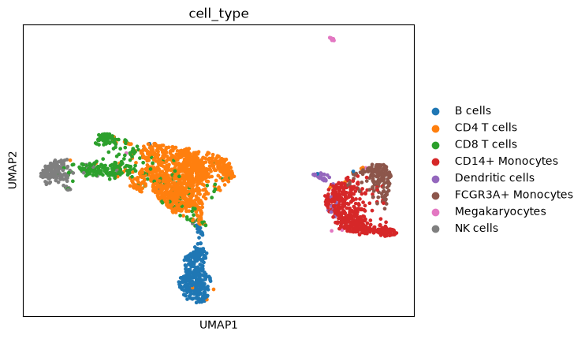

# Lesson 7. Embeddings

Before you start, open a terminal and run:

```bash
cd ~/geneformer-tutorial
conda activate geneformer
```

An **embedding** is a list of 768 numbers for each cell, read out of the
pretrained model. Nothing is trained in this lesson; the model is used as it
is ("frozen"). Cells that look alike to the model get similar lists of
numbers, which you can then plot or feed to a classifier.

You can do this in two ways. Use the CPU route on a laptop or on a Linux
CPU machine. Use the GPU route on a machine with an NVIDIA GPU, after the GPU
setup in [lesson 9](09-next-steps.md). The CPU route exists because Geneformer's own tool, `EmbExtractor`, only runs on an
NVIDIA GPU; the CPU route does the same calculation with plain
`transformers` code.

Both routes read the `<cls>` token from the second-to-last layer. That is
Geneformer's default for V2 models (`emb_mode="cls"`, `emb_layer=-1`; in
Geneformer, `emb_layer=-1` means the layer before the last, which the CPU code
reads as `hidden_states[-2]`).

## CPU route

Save as `embed_pbmc_cpu.py`:

```python
from pathlib import Path

import numpy as np
import pandas as pd
import torch
from datasets import load_from_disk
from transformers import BertModel

MODEL_DIR = "Geneformer/Geneformer-V2-104M"
N_CELLS = None  # None embeds all 2,638 cells; try 300 for a quick first pass

tokens = load_from_disk("pbmc/tokens/pbmc3k.dataset")
if N_CELLS is not None:
    tokens = tokens.shuffle(seed=42).select(range(N_CELLS))

# The checkpoint is saved as BertForMaskedLM; BertModel loads its encoder
# weights and ignores the masked-language-model head. A warning about unused
# or newly initialized pooler weights is expected; the pooler is not used here.
model = BertModel.from_pretrained(MODEL_DIR)
model.eval()

vectors = []
with torch.no_grad():
    for i, input_ids in enumerate(tokens["input_ids"]):
        out = model(input_ids=torch.tensor([input_ids]), output_hidden_states=True)
        penultimate = out.hidden_states[-2][0]  # (sequence length, 768)
        vectors.append(penultimate[0].numpy())  # position 0 is <cls>
        if (i + 1) % 100 == 0:
            print(f"{i + 1} / {len(tokens)} cells")

embeddings = pd.DataFrame(np.vstack(vectors), index=tokens["cell_id"])
embeddings["cell_type"] = tokens["cell_type"]
embeddings["split"] = tokens["split"]

Path("pbmc/results").mkdir(parents=True, exist_ok=True)
embeddings.to_csv("pbmc/results/pbmc3k_cls_embeddings.csv")
print(embeddings.shape)
```

This is the slowest step of the tutorial. In our test run on the CPU of
a 20-core ARM Linux machine, 300 cells took 2 minutes 14 seconds and all
2,638 cells took 19 minutes. A laptop will probably be slower; we have not
timed one. Do a short trial first: change the line
`N_CELLS = None` to `N_CELLS = 300`, run the script, and note the time. Then
set it back to `None` and run it for all cells (lesson 8 needs all of them).
On a remote machine, run the full job inside `tmux` (lesson 3, step 4) so it
survives a dropped connection.

```bash
python embed_pbmc_cpu.py
```

You should see a warning about weights that were "not used" or "newly
initialized" (expected, see the comment in the script), progress lines, and
finally:

```text
100 / 2638 cells
200 / 2638 cells
...
2600 / 2638 cells
(2638, 770)
```

770 columns: 768 numbers, plus `cell_type` and `split`.

## GPU route

Save as `embed_pbmc_gpu.py`:

```python
from pathlib import Path

from geneformer import EmbExtractor

Path("pbmc/results").mkdir(parents=True, exist_ok=True)  # EmbExtractor will not create it
extractor = EmbExtractor(
    model_type="Pretrained",
    num_classes=0,
    emb_mode="cls",
    emb_layer=-1,
    emb_label=["cell_id", "cell_type", "split"],
    max_ncells=None,
    forward_batch_size=16,
    nproc=4,
    model_version="V2",
)
embeddings = extractor.extract_embs(
    model_directory="Geneformer/Geneformer-V2-104M",
    input_data_file="pbmc/tokens/pbmc3k.dataset",
    output_directory="pbmc/results",
    output_prefix="pbmc3k_cls_embeddings",
)
print(embeddings.shape)
```

In the GPU test run this took about one minute, including
loading the model. `extract_embs` writes
`pbmc/results/pbmc3k_cls_embeddings.csv` and returns
the same table, with the label columns appended to the embedding columns.
`emb_mode="cell"` instead averages the gene vectors of each cell; the test run
in [`examples/lung-allograft`](../examples/lung-allograft/README.md) used
that mode.

## Look at the embeddings

768 numbers per cell are too many to look at. A **UMAP** plot squeezes them into
two dimensions so that cells that are close in the 768 numbers stay close on
the page. Save this as `plot_umap.py`; it works with the table from either
route:

```python
import anndata as ad
import pandas as pd
import scanpy as sc

table = pd.read_csv("pbmc/results/pbmc3k_cls_embeddings.csv", index_col=0)
labels = ["cell_type", "split", "cell_id"]
vectors = table.drop(columns=[c for c in labels if c in table.columns])

emb = ad.AnnData(vectors.to_numpy(dtype="float32"), obs=table[["cell_type"]].astype(str))
sc.pp.neighbors(emb, use_rep="X", random_state=0)
sc.tl.umap(emb, random_state=0)
sc.settings.figdir = "pbmc/results"
sc.pl.umap(emb, color="cell_type", save="_pbmc3k_cls.png", show=False)
```

```bash
python plot_umap.py
open pbmc/results/umap_pbmc3k_cls.png
```

From the test run (UMAP layouts vary slightly between machines, so yours
will not be identical):



`open` shows the picture on macOS. On a remote machine, copy it to your laptop
first, from a laptop terminal (for example
`scp gpu-box:geneformer-tutorial/pbmc/results/umap_pbmc3k_cls.png .`).

## Do the two routes agree?

Yes. In the test run we ran both routes on all 2,638 cells and
compared the vectors cell by cell: the cosine similarity was 1.000 for every
cell, and no number differed by more than 0.000003. The CPU route is the same
calculation as the GPU route, only slower.

## How to read the plot

In the test run, the lymphoid cells (T, B and NK cells) and the myeloid cells
(monocytes, dendritic cells) form two separate groups, and B cells, NK cells,
megakaryocytes and the two monocyte types each form their own cluster. CD4
and CD8 T cells overlap partly. The overlap comes from how the frozen model
sees these two closely related cell types; it does not mean the pipeline has
an error.

Keep two limits in mind. UMAP distorts global distances, so the space between clusters is not a measure of
biological difference; and with one donor, the plot cannot show whether the
model separates biology from donor or batch effects.

## You should now see

`pbmc/results/pbmc3k_cls_embeddings.csv` (about 2,638 rows) and a picture,
`pbmc/results/umap_pbmc3k_cls.png`, with dots coloured by cell type.

## Troubleshooting

| You see | What it means | What to do |
| --- | --- | --- |
| `OSError: ... Geneformer/Geneformer-V2-104M ...` or `Error while deserializing header` | The model folder is missing, or Git LFS did not download the real file | Run from `~/geneformer-tutorial`; check lesson 4, step 5 |
| `AssertionError: Torch not compiled with CUDA enabled` | The GPU route was run on a machine without a GPU | Use the CPU route |
| The script is killed, or the computer becomes very slow | Not enough memory or too many other programs open | Close other programs; set `N_CELLS = 300`; or run on a larger machine |

Previous: [6. Tokenize](06-tokenize.md) · Next: [8. Classify](08-classify.md)
