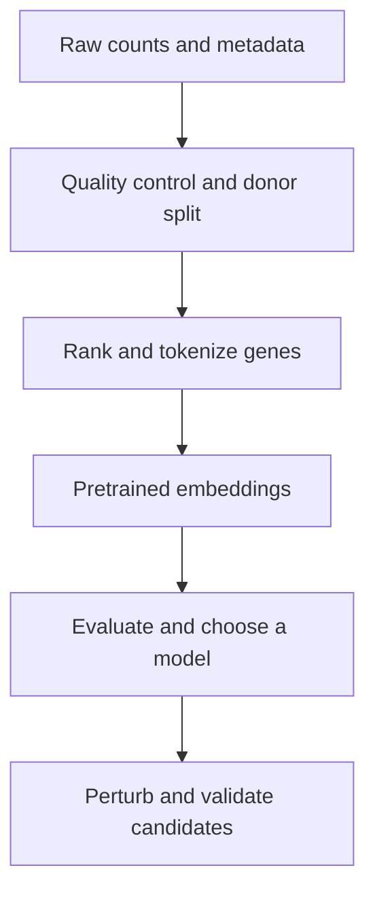

# Geneformer: from pretrained model to candidate targets

This companion to [lessons 5–10](05-prepare-data.md) explains the reasoning
behind the workflow. Read it after running the PBMC quickstart. It follows the
high-level sequence in Zhang et al.'s 2026 Geneformer protocol: tokenize,
inspect zero-shot embeddings, fine-tune and evaluate, then perturb and rank
candidates. The original 2023 paper describes both zero-shot and fine-tuned
applications. This guide is an interpretation of the published sources, not
an exact reproduction of every protocol setting. The 2026 paper is available
as a preview; consult the authors' tutorial for full procedural details.

## 1. Frame the question before training

Example: in lung CD8 T cells, can transcriptomes distinguish LUAD from
non-cancer, and which gene perturbations move LUAD cells toward the reference
state in the model? Cell-type classification is a different task: it predicts
CD8 T cell versus macrophage, for example. Restricting disease prediction to
one cell type reduces cell-composition confounding but does not eliminate
batch, donor, treatment or study differences.

Record sample, donor, study, tissue, cell type, disease and QC metadata.
Check counts of **donors as well as cells** in each label and study. Assign
entire donors to training, validation and final test sets before choosing
hyperparameters. Keep all samples from one donor together. If a disease occurs
only in one study or batch, disease and batch cannot be disentangled from
those data alone. Use study-held-out or external validation when feasible.
If only a few donors exist, performance is highly uncertain even if thousands
of cells are available. The one-donor PBMC tutorial demonstrates mechanics,
not generalization to new patients.

## 2. From counts to tokens

Supply the raw count matrix and Ensembl IDs as described in lessons 5–6.
Geneformer scales counts within a cell, divides by gene-specific reference
medians and orders detected genes by the resulting relative values. The input
is a ranked sequence of gene identifiers, not the original expression
magnitudes. Vocabulary coverage, duplicate mapping, filtering, sequence-length
truncation, and version-matched V1/V2 dictionaries matter. Preserve cell IDs
and metadata in the tokenized dataset and record the model, tokenizer and
code revision. A missing gene may be unmeasured, filtered, or below detection;
it is not automatically biologically absent.

## 3. What zero-shot means

The pretrained encoder has learned from masked-gene prediction. In **zero-shot
embedding**, its weights are unchanged for this new dataset; each cell is
converted to a vector. Compare cells using distances and visualize a UMAP,
coloring separately by disease, donor, study and cell type. A UMAP is useful
for exploration, but a two-dimensional picture cannot establish separation or
absence of confounding. Check the original embedding space, per-donor patterns,
and comparable cell numbers. Calculate any trained preprocessing on training
donors only.

| Approach | Task labels used? | What is trained for the task? |
| --- | --- | --- |
| Zero-shot embeddings | Not for training | Nothing; labels may be used for plotting or evaluation |
| Frozen embedding + classifier | Yes | A classifier on top of fixed vectors |
| Fine-tuned classifier | Yes | A classifier head and selected encoder weights |
| Zero-shot perturbation | Not for fitting the pretrained model | Nothing; state labels may define reference centroids |

Calling the *encoder* frozen does not make a supervised classifier zero-shot.
If labeled reference states are used to define a goal centroid, disclose that
use of labels even when no model weights are updated. Zero-shot for an unseen
gene, new donor, or new experimental condition can mean different things;
state the intended generalization explicitly.

## 4. Classification and fine-tuning

Start with a majority-class baseline and a supervised linear classifier on
frozen embeddings. Then compare a fine-tuned Geneformer under the **same
donor splits**, classes and evaluation protocol. In fine-tuning, a randomly
initialized classification head maps the cell representation to label scores;
the training loss updates the head and whichever encoder layers are unfrozen.
The learning rate controls update size, the batch size the number of cells per
step, and epochs the number of passes over training data. Freezing layers saves
memory and may limit overfitting, but is a choice to evaluate, not a guarantee.
Use validation donors for early stopping and model selection; touch the test
donors only after choices are fixed. An external cohort offers a stronger test.

Single-task learning predicts one label, such as LUAD versus normal in CD8 T
cells. Multitask learning trains on more than one label, for example cell type
and disease, using task-specific outputs and a shared representation. It may
exploit related signals but can also amplify confounding; it is not equivalent
to training cell type and then continuing training on disease. In sequential
training, the second stage starts from the first checkpoint and may overwrite
information learned in the first stage; evaluate both tasks again. Record the
exact checkpoint and architecture used for each stage.

Report the confusion matrix, class support, precision, recall and F1 for each
class, macro F1, and balanced accuracy where appropriate. Accuracy alone can
hide failures on rare classes. Report results per donor and uncertainty over
donors, not a confidence interval that treats correlated cells as independent.
For a clinical claim, evaluate at the patient level with a prespecified cell to
patient aggregation rule. A disease classifier can learn technical shortcuts;
predicting labels successfully does not itself identify mechanisms or prove
that representations are biologically causal.

## 5. In silico perturbation: the idea

For a cell, encode the original ranked sequence and a modified version through
the **same** model. Compare the original and modified embeddings. Each output
is a model response to an input edit, not measured gene expression after a
CRISPR experiment. The model is not retrained for each edit.

For illustration, let the cell's ordered genes be `A, B, C, D`. A deletion of
`C` gives `A, B, D`. An overexpression edit moves `C` to the front, giving
`C, A, B, D`. These are rank edits; they do not prescribe fold change, physical
dose, timing, efficiency, or the downstream count profile. Other genes' ranks
also shift as a consequence. An actual knockout or drug may have effects the
model does not reproduce.

| Question | Comparison | Meaning |
| --- | --- | --- |
| General impact | Original versus perturbed cell representations | How much the model representation changes; no therapeutic direction |
| Goal-directed shift | Perturbed versus original similarity to a reference-state centroid | Whether the representation moves toward that defined reference |
| Gene response | Remaining gene embeddings before versus after the edit | Which contextual representations change; not gene-level fold changes |

For example, if cosine similarity to the normal reference rises from 0.70 to
0.74 after deleting a gene, the illustrative shift is +0.04 toward that
centroid. It does **not** say the cell is 4% healthier. Cosine measures
direction in embedding space; its scale and sign must be read with the chosen
mode and software version. A large original-versus-perturbed distance alone
could indicate harm, nonspecific disruption, or movement to a different state.
Compare shifts toward the starting state, goal and plausible alternate states.

### Choose states and samples

Use biologically comparable cells, e.g. LUAD CD8 T cells as the start and
non-cancer CD8 T cells as the goal, with matching tissue and processing where
possible. Label and sample origins must be documented. Build state reference
embeddings with the **same checkpoint, layer, embedding mode and preprocessing**
as used for perturbations. For an unbiased held-out assessment, select the
checkpoint, states, target set and reference centroids using training and/or
validation donors; assess the frozen choices on separate test donors. If
centroids come from test data, call the analysis transductive and do not claim
independent test evaluation. Check centroid stability, donor representation,
state overlap and possible alternate outcomes; a mean can conceal multiple
cell states. Define separate analyses by cell type when comparing CD8 T cells
and macrophages. Different reference centroids can yield different rankings.

### Choose edits and understand the API

`InSilicoPerturber` operates on tokenized `.dataset` inputs and can use a
pretrained or compatible fine-tuned model. Current documentation lists
`delete` and `overexpress`; it marks `inhibit` and `activate` as TBA, so do
not assume they work in the installed revision. Confirm the exact API and
behavior against the code pinned by your environment. For a single-gene screen,
`genes_to_perturb="all"` with `combos=0` tests detected genes individually in
each cell. A **list of Ensembl IDs is perturbed together**, not individually;
to screen a small list one by one, run one singleton list per gene or filter
an all-gene screen afterward. Pair screens use `combos=1` and optionally an
anchor gene. Costs rise with the number of eligible gene–cell edits; start
with a small, donor-balanced pilot and log GPU time and memory.

Gene detection affects the tested population: deletion is meaningful only
where the gene is represented. Report detections and per-donor eligible cell
counts for every candidate, compare candidates with similar detection and
rank, and inspect selection effects. Overexpression behavior for genes absent
from a sequence is version- and mode-dependent; check the pinned source rather
than assuming every absent gene is added. Record IDs, token dictionary and
gene-symbol mapping.

### A practical analysis sequence

1. Define the hypothesis, start/goal/alternate states, cell type, donor splits,
   perturbation direction, candidate universe, and metrics before screening.
2. Extract original cell and state embeddings from the chosen checkpoint.
   Examine donor and batch structure and quality of state separation.
3. On a small balanced pilot, run the authors' [perturbation example](https://huggingface.co/ctheodoris/Geneformer/blob/main/examples/in_silico_perturbation.ipynb).
   Inspect the saved per-cell results, eligible genes and output files before
   scaling. `InSilicoPerturber` saves intermediate pickle files;
   `InSilicoPerturberStats` summarizes them into tables. Verify output columns
   and sign conventions against the installed source.
4. Compare candidates to appropriate control edits, including genes matched
   on detection frequency and rank where feasible, and assess negative and
   positive controls supported by independent evidence. Match the null to the
   statistic and eligible cells; a generic random distribution is not always
   a suitable null. Correct multiple testing for the stated family of tests.
5. Summarize effects within donor first and assess consistency across donors;
   a small cell-level p-value does not substitute for biological replication.
   Report effect size, direction, uncertainty, detection, donors, FDR and
   alternative-state shifts. Test sensitivity to seeds, centroids, dataset,
   checkpoint, and relevant sampling choices.
6. Reassess prespecified candidates in untouched donors or an independent
   dataset, and prioritize feasible experiments such as CRISPR perturbation
   with matched controls. Model predictions require experimental validation.

`InSilicoPerturberStats` offers different modes, including
`goal_state_shift`, `vs_null` and aggregation modes. Their assumptions and
inputs differ; a provided null is not automatically detection-matched, and a
single specified perturbation does not by itself provide random-gene controls.
Built-in cell-level statistics do not automatically solve donor dependence.
The [stats documentation](https://geneformer.readthedocs.io/en/latest/geneformer.in_silico_perturber_stats.html)
and pinned source describe the available modes. A prior perturbation benchmark
found that deep models did not consistently exceed simple baselines; include
appropriate baselines and real perturbation data where possible.

## Worked perturbation lessons

- [Peripheral blood immune cells](perturbation-peripheral-blood.md): plan a donor-aware stimulated-to-resting CD8 T-cell comparison.
- [Cardiomyocytes](perturbation-cardiomyocytes.md): compare disease modeling and candidate rescue using non-failing, DCM and HCM reference states.

Both are guided exercises; they require appropriate multi-donor datasets and have not been run end to end.

## 6. What to save and report

Keep a run manifest with input provenance and checksums, donor splits and
class counts, gene coverage, model and code revisions, configuration, random
seeds, hardware, checkpoint selection, state-centroid construction, edit
semantics, control design, exclusion rules and software versions. Save per-cell
results and donor-level summaries securely; do not commit patient data or model
weights to Git. Record whether each result is exploratory, validation or an
untouched test. The quickstart has been tested for embeddings; this advanced
guide has not been run end to end as a disease or perturbation experiment.

## Sources and next reading

- Zhang Y, Venkatesh MS, Theodoris CV. [Discovery of candidate therapeutic targets with Geneformer](https://doi.org/10.1038/s41596-026-01364-8), *Nature Protocols* (2026); [authors' tutorial](https://tinyurl.com/geneformertutorial).
- Theodoris CV et al. [Transfer learning enables predictions in network biology](https://doi.org/10.1038/s41586-023-06139-9), *Nature* (2023).
- [Geneformer model, code and examples](https://huggingface.co/ctheodoris/Geneformer); [perturber API](https://geneformer.readthedocs.io/en/latest/geneformer.in_silico_perturber.html).
- [Deep-learning-based gene perturbation effect prediction does not yet outperform simple linear baselines](https://doi.org/10.1038/s41592-025-02772-6), *Nature Methods* (2025).

Return to [classification](08-classify.md), [GPU and next steps](09-next-steps.md), or [real-run lessons](10-lessons-from-real-runs.md).
